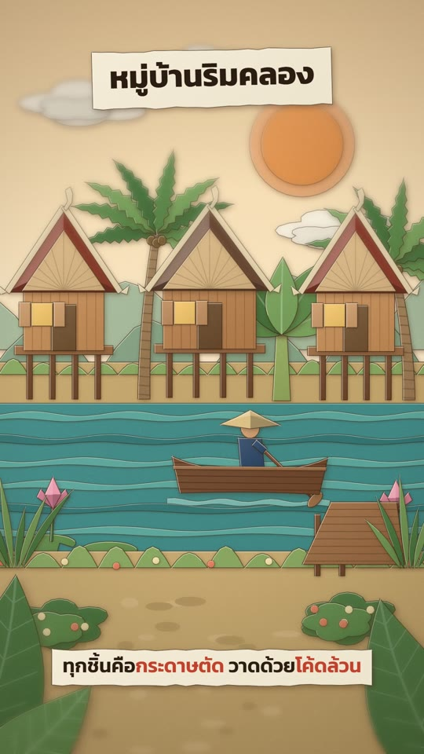

# kradas

**Cut-paper story clips, drawn in code.** Vertical 9:16 scenes that pop up like a paper diorama, with paper
fold sounds and Thai-ready captions, rendered straight to mp4.



kradas (กระดาษ) means paper in Thai. It is a tiny dependency-free browser kit plus a headless renderer, made for
short videos on Reels, TikTok and YouTube Shorts. It also ships as an agent skill (`SKILL.md`), so Claude Code
or any agent that reads skills can build a clip from a sentence.

- **No images, no 3D models.** Every house, tree and boat is layered paper sheets drawn on a canvas.
- **One page = one clip.** The same HTML plays in the browser and renders frame by frame, so the preview is the
  final video.
- **Sound included.** Paper folds, rustles and slides are synthesized from the same timeline as the picture.
- **Thai first.** Captions wrap Thai text at word boundaries and sit on torn paper strips.

## Quick start

Requires Node 22+, Google Chrome and ffmpeg.

```bash
git clone https://github.com/keaykub/kradas
cd kradas
npm run serve
```

Open http://127.0.0.1:5180/examples/canal-village/ to watch the demo. Then render it:

```bash
npm run render -- examples/canal-village
```

## Make your own clip

```bash
cp -r templates/story stories/my-clip
```

Edit `stories/my-clip/scene.js`:

```js
import { P } from '../../lib/core.js'
import { sheet, fold, rect } from '../../lib/paper.js'
import { popUp } from '../../lib/motion.js'
import { subtitles } from '../../lib/text.js'
import { stage } from '../../lib/stage.js'

const AT = { house: 1.0 }

stage({
  duration: 6,
  draw(c, t) {
    sheet(c, rect(0, 0, 1080, 1100), '#f4dcae', { lift: 0 })
    sheet(c, rect(0, 1100, 1080, 820), '#c7a86c')
    popUp(c, t, AT.house, P(540, 1200), () => {
      sheet(c, rect(460, 1020, 160, 180), '#c58d57')
      fold(c, [P(430, 1030), P(540, 900), P(650, 1030)], '#8c3b2a', { apex: P(540, 990) })
    })
  },
  overlay(c, t) {
    subtitles(c, t, [['บ้านหลังแรก', 1.5, 5.5]])
  },
  sound(k) {
    k.fold(AT.house)
  },
})
```

Preview with `?t=3` to freeze a moment, then `npm run render -- stories/my-clip`.

## Walkable worlds

The same paper pieces also stand up in 3D. `world/` turns them into a little web world you can walk around:
everything lies flat on the page like a print and folds up with a paper sound as you get close, signs tell a
story when you reach them, and a shallow lens keeps the focus on your character.

```bash
npm run serve
```

Open http://127.0.0.1:5180/examples/walk-village/ and walk with WASD, the arrow keys, or touch and drag on a
phone. It uses three.js from a CDN through an import map, so there is still nothing to install.

```js
import { paint, card } from '../../world/cards.js'
import { createWorld } from '../../world/engine.js'
import { stiltHouse, kid } from '../../lib/props.js'

const player = card([paint(180, 250, c => kid(c, { frame: 0 })), paint(180, 250, c => kid(c, { frame: 1 }))], { height: 1.75 })
const world = createWorld({ title: 'My village', ground, player })
world.place(card(paint(380, 560, c => stiltHouse(c)), { height: 5.4 }), { x: 4, z: -6, reach: 12 })
world.addSign(signCard, { x: 2, z: 4, title: 'Hello', text: 'Walk up to things to unfold them.' })
world.start()
```

The demo is three realms joined by portal gates:

| Realm | Page | Mood |
|---|---|---|
| Mortal village | `examples/walk-village/` | a Thai canal village by day: folded stilt houses, market, temple, rice fields |
| Immortal realm | `examples/realm-immortal/` | jade islands above a sea of mist: pagodas, old pines, cranes, sword riders |
| Demon realm | `examples/realm-demon/` | night under a blood moon: lava cracks, lanterns, fortresses, spirit fires |

Each realm is one scene file plus a `theme` (light, fog, sky, bloom, particles) passed to `createWorld`.
Houses are real folded boxes (`foldedHouse`), trees are crossed cards (`card(..., { cross: true })`), and
`addLight` / `addPortal` add glowing lamps and gates.

To film a walk without dropped frames, add a `tour` to the scene and capture it frame by frame:

```bash
node scripts/capture-world.mjs "examples/walk-village/?rec=1&tour=walk" out/walk 12 --size 1080x1920
```

It steps the world at a fixed 1/30 s, saves `f0001.jpg ...` and renders the paper sounds to `sound.wav`.

`ground` is a texture from `groundTexture(size, draw)` and `signCard` is any card, for example one painted with
`signBoard`. See `examples/walk-village/village.js` for the full village.

## Use it with an AI agent

Copy this folder into your agent's skills directory (for Claude Code: `~/.claude/skills/kradas`), then ask:

> Make a 15 second kradas clip of a night market by the river, with three captions.

The agent follows `SKILL.md`: it plans the beats, builds the scene back to front, scores the paper sounds from
the same timeline, checks freeze frames and renders the mp4.

## What is inside

| Module | What it gives you |
|---|---|
| `lib/paper.js` | `sheet` and `fold` (cut paper with lit edges and lifted shadows), shape builders, lens blur, grain |
| `lib/motion.js` | spring pop-ups from a hinge, slides, sway, camera keyframes |
| `lib/text.js` | torn-paper labels, timed captions, Thai word wrapping |
| `lib/sound.js` | offline-rendered paper foley and soft music |
| `lib/stage.js` | the player (play, scrub, sound) and the record hooks used by the renderer |
| `scripts/render.mjs` | headless Chrome to mp4 at any fps, with the soundtrack muxed in |

## License

MIT © 2026 keaykub
