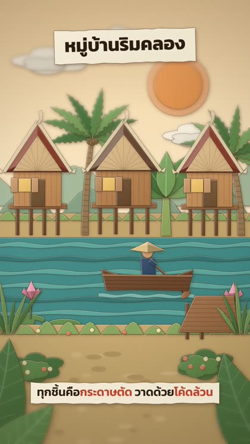

# kradas

**A paper world you can walk into, drawn entirely in code.** Houses, trees and people lie flat on the page like
prints, then fold up around you as you walk. Three realms are joined by portal gates.


kradas (กระดาษ) means paper in Thai. There are no image files and no 3D models: every piece is layered cut paper
painted on a canvas, then stood up in three.js as folded boxes and crossed cards.

| Realm | Page | What is there |
|---|---|---|
| Mortal village | `examples/walk-village/` | a Thai canal village by day: folded stilt houses, market, temple, rice fields, villagers and animals |
| Immortal realm | `examples/realm-immortal/` | jade islands above a sea of mist: pagodas, old pines, cranes, sword riders |
| Demon realm | `examples/realm-demon/` | night under a blood moon: lava cracks, glowing lanterns, fortresses, spirit fires |

## Play it

Requires Node 22+ and a browser. Nothing to install: three.js loads from a CDN through an import map.

```bash
git clone https://github.com/keaykub/kradas
cd kradas
npm run serve
```

Open http://127.0.0.1:5180/examples/walk-village/ and walk with WASD, the arrow keys, or touch and drag on a
phone. Walk south to find the two gates into the other realms. Signs tell a short story when you reach them.

## How it works

- **Paper art** (`lib/paper.js`, `lib/props*.js`): `sheet` and `fold` draw cut paper with a dark cut line, a lit
  edge, a lifted shadow and paper fibre. Props such as `stiltHouse`, `pagoda`, `mangoTree` or `villager` are just
  stacks of sheets.
- **Cards** (`world/cards.js`): `paint` turns a drawing into a texture, `card` stands it up (use `cross: true`
  for trees), `stack` layers several, and `foldedHouse` builds a real box with walls, a pitched roof and stilts.
- **Engine** (`world/engine.js`): `createWorld` gives you the player, touch and keyboard controls, collisions,
  pop-up springs with paper sounds, story signs, portals, point lights, a tilt-shift lens that follows the player,
  and a `theme` (light, fog, sky, bloom, drifting petals or embers) per realm.

```js
import { paint, card, foldedHouse, groundTexture } from '../../world/cards.js'
import { createWorld } from '../../world/engine.js'
import { kid, signBoard } from '../../lib/props.js'
import { mangoTree } from '../../lib/props-places.js'

const player = card([0, 1].map(frame => paint(180, 250, c => kid(c, { frame }))), { height: 1.75 })
const world = createWorld({ title: 'My village', ground: groundTexture(2048, drawGround), player })
world.place(card(paint(520, 480, c => mangoTree(c)), { height: 5, cross: true }), { x: 4, z: -6, sway: 0.02 })
world.addSign(card(paint(280, 270, c => signBoard(c, { title: 'Hello' })), { height: 1.9 }), { x: 2, z: 4, title: 'Hello', text: 'Walk up to things to unfold them.' })
world.start()
```

Each realm is one scene file: see `examples/walk-village/village.js` for the full village.

## Film a walk

To record a walk without dropped frames, give the scene a `tour` and capture it frame by frame (needs Chrome and
ffmpeg):

```bash
node scripts/capture-world.mjs "examples/walk-village/?rec=1&tour=walk" out/walk 12 --size 1080x1920
```

It steps the world at a fixed 1/30 s, saves `f0001.jpg ...` and renders the paper sounds to `sound.wav`.

## Also inside: a 2D clip kit



The same paper art also makes flat 9:16 story clips for Reels, TikTok and Shorts, with Thai-aware captions on
torn paper strips and synthesized fold sounds, rendered straight to mp4:

```bash
npm run render -- examples/canal-village
```

Copy `templates/story/` to start your own. `SKILL.md` teaches an AI agent (Claude Code or any agent that reads
skills) to build a clip from one sentence.

## License

MIT © 2026 keaykub
