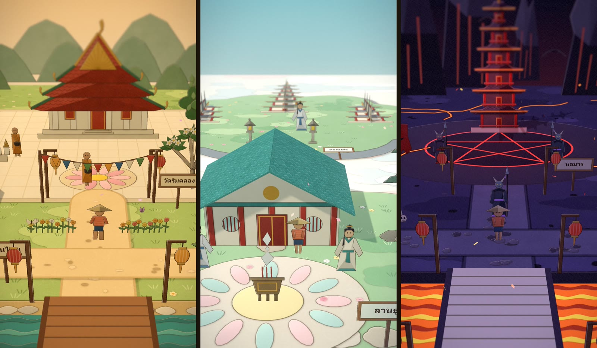

# kradas ภาษาไทย

**โลกกระดาษที่เดินเข้าไปเที่ยวได้ เขียนด้วยโค้ดล้วน** บ้าน ต้นไม้ และผู้คนนอนราบเป็นลายบนกระดาษ แล้วพับตั้งขึ้นรอบตัวเมื่อเดินเข้าใกล้
มีสามแดนเชื่อมกันด้วยประตู: แดนธรรมดา (หมู่บ้านริมคลอง) แดนเซียน (เกาะหยกเหนือทะเลหมอก) และแดนมาร (กลางคืนใต้จันทร์เลือด)



- ไม่ใช้ไฟล์รูปและไม่ใช้โมเดล 3D ทุกชิ้นคือกระดาษตัดซ้อนชั้นที่วาดบน canvas แล้วตั้งขึ้นใน three.js
- เดินด้วย WASD ปุ่มลูกศร หรือแตะค้างแล้วลากบนมือถือ
- เปิดดู: `npm run serve` แล้วเข้า http://127.0.0.1:5180/examples/walk-village/ เดินลงใต้จะเจอประตูไปอีกสองแดน
- ใน repo ยังมีชุดทำคลิปกระดาษตัด 2D แนวตั้ง 9:16 ที่ render เป็น mp4 ได้ (ดูหัวข้อด้านล่าง)

## ชุดทำคลิป 2D: เริ่มใช้

ต้องมี Node 22 ขึ้นไป, Google Chrome และ ffmpeg

```bash
git clone https://github.com/keaykub/kradas
cd kradas
npm run serve
```

เปิด http://127.0.0.1:5180/examples/canal-village/ ดูฉากหมู่บ้านริมคลอง แล้ว render เป็นคลิป:

```bash
npm run render -- examples/canal-village
```

## ทำคลิปของตัวเอง

1. ก๊อป `templates/story` ไปเป็นโฟลเดอร์ใหม่ เช่น `stories/my-clip`
2. แก้ `scene.js`: เขียนเวลาที่แต่ละชิ้นเด้งขึ้นไว้ใน `AT` วาดฉากจากหลังมาหน้าใน `draw` ใส่ซับใน `overlay` และใส่เสียงใน `sound`
3. ดูเฟรมที่ต้องการด้วย `?t=3` ต่อท้าย URL
4. `npm run render -- stories/my-clip`

## ใช้กับ AI

ก๊อปโฟลเดอร์นี้ไปไว้ในโฟลเดอร์ skills ของ agent (Claude Code: `~/.claude/skills/kradas`) แล้วสั่งได้เลย เช่น

> ทำคลิป kradas 15 วินาที ตลาดน้ำยามเช้า มีซับ 3 ประโยค

AI จะทำตาม `SKILL.md`: วางจังหวะ สร้างฉาก ใส่เสียง เช็กภาพนิ่ง แล้ว render เป็น mp4

## License

MIT © 2026 keaykub
